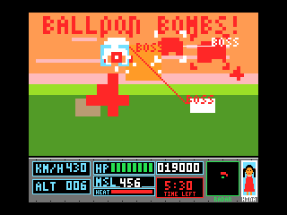
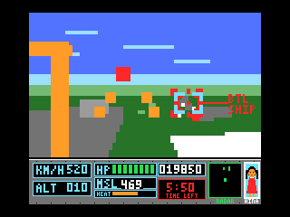
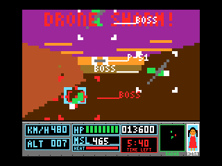
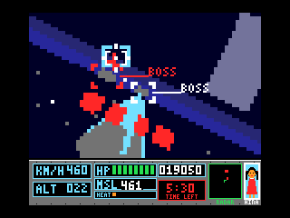
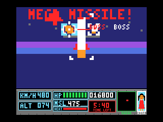
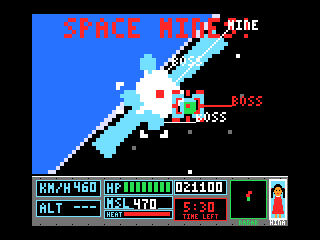
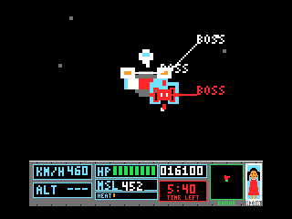

# PAPA ZERO

<p align="center">
  
</p>

> ⚠️ **Work in progress.** Published for feedback and experimentation.
> **開発中の作品です。** フィードバックと実験のために公開しています。

A cockpit-view 3D rail shooter for the **MSX turboR** (V9958 VDP · R800). A father climbs into a
heavily modified Zero fighter and chases the terrorists who kidnapped his daughter — across a captured
town, a harbor, a canyon, a sea of clouds, the stratosphere, and into orbit.

**Repository:** <https://github.com/suzuki-black/PapaZeroR>. The 3D engine grew out of
**[CoasterHomeRunR](https://github.com/suzuki-black/CoasterHomeRunR)** (a 3D rail shooter in SCREEN 3).

<table>
  <tr>
    <td><br><sub><b>OPENING</b> — the Zero by the barn / 納屋の前の零戦</sub></td>
    <td><br><sub><b>1 THE TOWN</b> — balloon bombs / 気球の爆弾</sub></td>
  </tr>
  <tr>
    <td><br><sub><b>2 THE HARBOR</b> — battleships in the bay / 港の戦艦</sub></td>
    <td><br><sub><b>3 THE CANYON</b> — HYDRA and its drone swarm / ヒュドラとドローンの群れ</sub></td>
  </tr>
  <tr>
    <td><br><sub><b>4 THE CLOUD SEA</b> — the air battleship GRAF ZEPPELIN II and its flak / 空中戦艦グラーフ改の対空砲火</sub></td>
    <td><br><sub><b>5 THE STRATOSPHERE</b> — a mega missile / 大きな誘導弾</sub></td>
  </tr>
  <tr>
    <td><br><sub><b>6 THE ORBIT</b> — the keyhole base above the Earth / 地球の上の鍵穴の基地</sub></td>
    <td><br><sub><b>7 DEEP SPACE</b> — the ark carrying Hina / ヒナを乗せた方舟</sub></td>
  </tr>
</table>

**Language:** [🇬🇧 English](#english) · [🇯🇵 日本語](#japanese)

---

<a name="english"></a>
## English

- [Story](#story)
- [Overview](#overview)
- [Features](#features)
- [Stages](#stages)
- [Controls](#controls)
- [Cockpit](#cockpit)
- [Requirements](#requirements)
- [Download](#download)
- [Building](#building)
- [Running](#running)
- [Project structure](#project-structure)
- [Documentation](#documentation)
- [Scope & honest positioning](#scope--honest-positioning)
- [Credits](#credits)
- [License](#license)
- [Disclaimer](#disclaimer)

### Story

> A quiet morning on the farm. The father looks away for a moment — and in that moment a terrorist
> group that has already seized the nearest town lands a jet on his road, and two of its men carry his
> daughter Hina away. In six hours she will be put on a rocket. He does not call the police.
> He runs to the barn, where an old Zero stands, rebuilt far beyond anything its makers imagined.

### Overview
- **Platform:** MSX turboR software (4 Mbit (512 KB) ASCII8 MegaROM). The engine assumes the R800.
- **Genre:** Single-player cockpit-view 3D rail shooter.
- **Screen:** the top 160 lines are the 3D view in SCREEN 3 (64 × 40 blocks, double-buffered);
  the bottom 52 lines are the cockpit instruments in a bitmap mode, split by a raster interrupt.
- **Structure:** opening → 7 stages (the town, the harbor, the canyon, the cloud sea, the stratosphere,
  the orbit, deep space), each ending with a boss and its secret weapon → a short film between stages →
  ending film and staff roll. The TIME LEFT clock counts down from 06:00 as you play; how much is left
  changes the father-and-daughter talk in the ending.

### Features
- **Real-time 3D in SCREEN 3** at up to 30 fps: flat-shaded polygons, a tilting horizon, LOD down to
  pre-drawn rectangles for distant objects.
- **Vulcan and homing missiles.** Anything inside the lock frame around the sight is locked (up to 8);
  each press of the missile key fires at the locked enemies in turn.
- **Enemy shots can be shot down** — the main way to defend yourself, as in other games of this kind.
- **Manoeuvre prompts** (`ROLL!` `LOOP!` `DIVE!`) with spoken calls.
- **"AI recognition" name labels.** The Zero's image recognition tags enemies and supplies with sprite
  labels and leader lines. Labels are staggered so no more than three share a line, so they never flicker.
- **Opening and between-stage scenes are films** timed to their music: key-framed cameras and actors
  driven by the same 60 Hz clock as the music, so picture and score never drift. People, the kidnappers'
  jet and tanks are drawn as two-layer magnified sprites so they can be told apart at 64 × 40.
- **Music:** MSX-MUSIC (YM2413) with a PSG layer, all original. **Voices** on the turboR internal PCM
  ("Fire!", "Papa, hurry!" …), generated with Flite.
- **Attract mode** (a cockpit guide, then a demo) after 30 seconds on the title screen, and a hidden settings menu.

### Stages
| # | Title | Time of day | Boss |
|---|---|---|---|
| 1 | THE TOWN | Morning | Five balloons |
| 2 | THE HARBOR | Noon | KONIGS KRABBE, a walking tank |
| 3 | THE CANYON | Dusk | HYDRA, three P-51s joined together |
| 4 | THE CLOUD SEA | Night | GRAF ZEPPELIN II, an air battleship |
| 5 | THE STRATOSPHERE | Twilight | DOPPELGANGER II, a super fighter |
| 6 | THE ORBIT | Space | The keyhole base |
| 7 | DEEP SPACE | Deep space | The ark, with Hina's capsule on board |

Every boss has a secret weapon it announces before firing (balloon bombs, crab missiles, a drone swarm, a flak
curtain, a mega missile, space mines; stage 7 uses them all in turn). A short film plays between stages.

### Controls
| Input | Action |
|-------|--------|
| Arrow keys | Move the sight |
| Space | Vulcan · start · skip the opening |
| **M** or **B** | Homing missile (while a prompt is shown it also performs the manoeuvre; a missile still fires if anything is locked) |
| **F1** | Pause / resume (during the stages and the films between them; not on the title, the demo or the ending). Please don't use the turboR's own pause key |
| ↑↑↓↓←→←→ B A on the title screen | Hidden settings menu (damage, invincibility, starting stage, lives, one-shot, FPS display, transfer, split, roll, size of the missile lock-on box, FILM: watch only the films) |
| M on the title screen | Sound test (↑↓ choose, ←→ switch between music, effects and voices, Space plays, M returns) |

- **Vulcan:** hold Space to fire at whatever is under the sight (the sight turns red over a target).
  Firing heats the gun (HEAT); when it is full the gun stops for about a second.
- **Missiles:** any enemy that touches the cyan box around the sight is locked (up to 8; they get red marks
  and name tags). Each press of M fires one missile at the locked targets in turn. You get 500 per stage (MSL);
  green AMMO balloons add 50, MED balloons repair HP.
- **ROLL! / LOOP! / DIVE!:** press M while the prompt flashes to dodge a laser or shake off a pursuer.

### Cockpit
The bottom of the screen is the instrument panel. Leave the title screen alone for 30 seconds and a short guide
walks through it, one instrument at a time, before the demo.

| Instrument | What it shows |
|------------|---------------|
| KM/H | Air speed |
| ALT | Altitude (`---` in space) |
| HP | Armor, 8 segments. Turns red when only 2 are left; the windshield cracks as you take hits |
| MSL | Homing missiles left (500 per stage) |
| HEAT | Gun heat. When full, the Vulcan stops for about a second |
| Top right | Score |
| TIME LEFT | Hours left to save Hina. Starts at 6:00 and runs down as you play; at 1:00 Hina calls for you. It changes what she says in the ending |
| RADAR | You are in the middle, facing up. Green dots are enemies, red dots the boss |
| HINA | Your daughter's photo |

### Requirements
- **Target hardware: MSX turboR** (FS-A1ST / FS-A1GT).
- The turboR system ROM is copyrighted and is **not** included. Development and testing are done in
  [openMSX](https://openmsx.org/) with a machine built from a dumped turboR BIOS.
- The author has also played it through to the ending on real hardware (FS-A1ST).
- Known issues on real hardware:
  - After explosions or rolls, old blocks sometimes stayed on the 3D view (they cleared when the lock-on frame
    passed over them; this never happens in openMSX). A fix is in, but it has not been confirmed on real hardware yet.
  - The hardware pause key freezes the game; pressing it again does not resume. Use F1 to pause instead.
- The author's machine is not in good shape, so fixes that need testing on real hardware may have to wait.
- The ROM also runs in [WebMSX](https://webmsx.org/) (turboR machine); the official WebMSX does not
  emulate the turboR PCM, so the voices may be silent there.

### Download
The ROM is on the [Releases page](https://github.com/suzuki-black/PapaZeroR/releases/latest). The zip holds
`PapaZero [ASCII8].rom`, a 512 KB ASCII8 MegaROM image, and the license. It needs an MSX turboR (or openMSX with a
turboR machine).

### Building
Requires [SDCC](https://sdcc.sourceforge.net/) and Python 3 with Pillow. [Flite](http://www.festvox.org/flite/)
is needed only to regenerate the voices (`sh tools/gen_voice.sh`).

```bash
make
```

This produces `build/PapaZero.rom` and a copy named `build/PapaZero [ASCII8].rom` for WebMSX.
`make fpsrom` builds a ROM with an FPS counter. If the default `python3` has no Pillow,
pass the interpreter: `make PYTHON=python3.14`.

### Running
```bash
openmsx -machine Panasonic_FS-A1ST -carta build/PapaZero.rom -romtype ASCII8
```

In WebMSX, drag and drop `build/PapaZero [ASCII8].rom` onto a turboR machine.

### Project structure
```
src/boot/      cartridge loader (bank 0)
src/engine/    engine: VDP and raster split, 3D transform and polygon fill, game loop, HUD, sound, PCM,
               op.c (the film player for the opening and the scenes between stages)
src/sound/     songs.mml (all music) and the voice module
tools/         generators: stage_data.py / content.py (stages, models, films), gen_stage.py, gen_music.py,
               gen_data.py (fonts, sprites), gen_cockpit.py, gen_title.py / gen_title_text.py, mkrom.py (MegaROM packer),
               test_flow.tcl (openMSX autoplay test)
data/          title illustration (title_art.webp) and its lettering (title_text.png)
docs/          development notes
```

### Documentation
- **[Design spec / 指示書](docs/指示書.md)** — what the game is and how it is built (screens, rules, enemies, stages, rendering, sound, memory map).
- **[Verification log / 検証記録](docs/検証記録.md)** — every problem found in testing, how it was measured and fixed.
- **[TODO](docs/TODO.md)** — what is left.
- **[CHANGELOG](CHANGELOG.md)**.

### Scope & honest positioning
**[CoasterHomeRunR](https://github.com/suzuki-black/CoasterHomeRunR)** showed that real-time 3D is possible in
SCREEN 3 on the turboR. PAPA ZERO pushes that further, aiming for a cinematic cockpit-view 3D shooter in the spirit
of *Starblade* on the MSX: a cockpit you sit in, enemies and their shots coming at the screen, and films between the
stages.
- The whole game is in place: the opening, seven stages with their bosses, the films between them, the ending and
  the staff roll. The author has played it through from the title to the ending, in openMSX and on real hardware.
- 64 × 40 blocks is coarse, so the 3D is about readable shapes and framing rather than detail.
- Known issues on real hardware are listed under Requirements. What is still open is in [TODO](docs/TODO.md).

### Credits
- **Original Concept / Direction:** suzuki-black
- **Program / Graphics / Music:** Claude Code (Anthropic Claude) — all music is original
- **Title illustration:** Microsoft Copilot (from a brief written with Claude Code: [docs/タイトル画像の依頼.md](docs/タイトル画像の依頼.md))
- **Title lettering font:** [Anton](https://fonts.google.com/specimen/Anton) — SIL Open Font License 1.1 (the font file is not
  included in this repository; `tools/gen_title_text.py` renders the lettering once into `data/title_text.png`)
- **Voices:** [Flite](http://www.festvox.org/flite/) (Carnegie Mellon University), `rms` voice

### License
**MIT** © 2026 suzuki-black. See [LICENSE](LICENSE).

### Disclaimer
The aircraft and vehicles that appear (the Zero, the P-51 and others) only borrow historical names and
shapes. Their shapes, colors and performance are changed for the game and are not accurate depictions
of real equipment. No specific game's names, characters, images or audio are used. *Starblade* is named above
only as the kind of game this aims at; PAPA ZERO is not affiliated with it or its rights holders.

---

<a name="japanese"></a>
## 日本語

- [あらすじ](#あらすじ)
- [概要](#概要)
- [特徴](#特徴)
- [ステージ](#ステージ)
- [操作](#操作)
- [計器盤](#計器盤)
- [動作環境](#動作環境)
- [ダウンロード](#ダウンロード)
- [ビルド](#ビルド)
- [実行](#実行)
- [ディレクトリ構成](#ディレクトリ構成)
- [ドキュメント](#ドキュメント)
- [位置づけ](#位置づけ)
- [クレジット](#クレジット)
- [ライセンス](#ライセンス)
- [免責](#免責)

### あらすじ

> 農場の静かな朝。父がほんの少し目を離した隙に、すでに一番近い町を制圧していたテロ集団が
> 戦闘機で家の前の道に降り、2 人組が娘のヒナをさらっていった。6 時間後、ヒナはロケットに乗せられる。
> 父は警察を呼ばなかった。納屋へ走る。そこには、作った者の想像をはるかに超えて手を入れた、古い零戦がある。

### 概要
- **対応機種:** MSX turboR 用ソフト（4 メガビット（512KB）の ASCII8 メガROM）。R800 を前提に設計しています。
- **ジャンル:** 1 人用・コクピット視点の 3D レールシューター。
- **画面:** 上 160 ラインが SCREEN 3（64 × 40 ブロック、ダブルバッファ）の 3D、下 52 ラインがビットマップのモードの
  計器盤。走査線割込みで分けています。
- **構成:** オープニング → 全 7 面（町・港・谷・雲海・成層圏・軌道・深宇宙。各面の最後に秘密兵器を持つボス）→
  面と面の間の短い映像 → エンディングの映像とスタッフロール。残り時間（TIME LEFT）は 06:00 から遊んだ時間で減り、
  エンディングの親子の会話が、残った時間で変わります。

### 特徴
- **SCREEN 3 でリアルタイムの 3D**（上限 30fps）。面の塗りつぶし、傾く地平線、遠くの物体は前もって描いた矩形へ落とす LOD。
- **バルカンと誘導弾**。照準のまわりの枠に入った敵をロックし（8 体まで）、誘導弾のキーを押すたびに、ロックした敵へ順に撃ちます。
- **敵弾を撃ち落とせる**。同じ系統のゲームと同じく、これが主な守りです。
- **機動の指示**（`ROLL!` `LOOP!` `DIVE!`）と声。
- **「AI 画像認識」の名前の札**。零戦の画像認識という体裁で、敵と補給にスプライトの札と引き出し線を付けます。
  札は同じ高さに 3 枚までになるよう上下にずらすので、ちらつきません。
- **オープニングと面の間の場面は、曲に合わせて動く映像**。カメラと役者のキーフレームを、曲と同じ 60Hz の時計で
  動かすので、絵と曲はずれません。人物・誘拐の戦闘機・戦車は 2 枚重ねの拡大スプライトで描き、64 × 40 でも見分けがつきます。
- **音楽:** MSX-MUSIC（YM2413）に PSG を重ねた、すべてオリジナルの曲。**声**は turboR 内蔵 PCM（「Fire!」「Papa, hurry!」など。Flite で作成）。
- タイトルで 30 秒待つと計器盤の説明とデモ。隠しの設定メニュー。曲・効果音・声を聴けるサウンドテスト。

### ステージ
| 面 | 名前 | 時刻 | ボス |
|---|---|---|---|
| 1 | THE TOWN（町） | 朝 | 気球 5 個 |
| 2 | THE HARBOR（港） | 昼 | ケーニヒス・クラブ（歩く戦車） |
| 3 | THE CANYON（谷） | 夕 | ヒュドラ（P-51 を 3 機つないだもの） |
| 4 | THE CLOUD SEA（雲海） | 夜 | グラーフ改（空中戦艦） |
| 5 | THE STRATOSPHERE（成層圏） | 薄明 | ドッペルゲンガー改（超戦闘機） |
| 6 | THE ORBIT（軌道） | 宇宙 | 鍵穴の基地 |
| 7 | DEEP SPACE（深宇宙） | 深宇宙 | 方舟（ヒナのカプセル付き） |

どのボスも、名前を出してから秘密兵器を撃ちます（気球の爆弾・カニの誘導弾・ドローンの群れ・対空砲火の幕・大きな誘導弾・機雷。
7 面は全部を順に）。面と面の間には短い映像が入ります。

### 操作
| 入力 | 動作 |
|------|------|
| カーソルキー | 照準を動かす |
| スペース | バルカン・開始・オープニングを飛ばす |
| **M** または **B** | 誘導弾（指示が出ている間は機動もする。ロックがあれば誘導弾も撃つ） |
| **F1** | 一時停止・再開（面の道中と、オープニング・面の間の映像で。タイトル・デモ・エンディングでは止まりません）。turbo R 本体のポーズキーは使わないでください |
| タイトルで ↑↑↓↓←→←→ B A | 隠しの設定メニュー（ダメージ・無敵・開始面・残機・一撃・FPS 表示・転送・分割・ロール・誘導弾のロックの枠の大きさ・映像の場面だけを見る FILM） |
| タイトルで M | サウンドテスト（↑↓ で選ぶ、←→ で曲・効果音・声を切り替え、スペースで鳴らす、M で戻る） |

- **バルカン:** スペースを押している間、照準の下の敵を撃ちます（敵に重なると照準が赤くなります）。
  撃ち続けると銃が熱くなり（HEAT）、いっぱいになると 1 秒ほど撃てません。
- **誘導弾:** 照準のまわりの水色の枠に少しでもかかった敵をロックします（8 体まで。赤い印と名前の札が付きます）。
  M を押すたびに、ロックした敵へ順に 1 発ずつ撃ちます。面ごとに 500 発（MSL）。緑の AMMO の気球で 50 発、
  MED の気球で耐久（HP）が戻ります。
- **ROLL! / LOOP! / DIVE!:** 文字が点滅している間に M を押すと、レーザーを避けたり、後ろの敵を振り切ったりします。

### 計器盤
画面の下は計器盤です。タイトルで 30 秒待つと、デモの前に計器を 1 つずつ指して説明する画面が流れます。

| 計器 | 表すもの |
|------|----------|
| KM/H | 速度 |
| ALT | 高度（宇宙では `---`） |
| HP | 機体の耐久（8 目盛り）。残り 2 で赤くなる。被弾が重なると風防にひびが入る |
| MSL | 誘導弾の残り（面ごとに 500） |
| HEAT | 機銃の熱。いっぱいになると 1 秒ほどバルカンが撃てない |
| 右上 | 得点 |
| TIME LEFT | ヒナを助けるまでの残り時間。6:00 から遊んだ時間で減り、1:00 でヒナが呼ぶ。エンディングのヒナの台詞が変わる |
| RADAR | 真ん中が自機（上が進む向き）。緑の点は敵、赤い点はボス |
| HINA | 娘の写真 |

### 動作環境
- **MSX turboR**（FS-A1ST / FS-A1GT）。
- turboR 本体 ROM は著作物のため**同梱していません**。開発と検証は [openMSX](https://openmsx.org/) で、
  実機の BIOS を吸い出した機種定義を使って行っています。
- 作者が実機（FS-A1ST）でもエンディングまで遊んでいます。
- 実機で分かっている問題:
  - 爆発やロールの後に、3D 画面へ古いブロックが残ることがありました（照準の枠が重なると消えます。openMSX では起きません）。
    対策を入れましたが、実機ではまだ確かめていません。
  - ハードウェアのポーズキーを押すとフリーズし、もう一度押しても戻りません。一時停止は F1 を使ってください。
- 作者の実機の調子が悪く、実機での確認が要る直しは、しばらくできないかもしれません。
- [WebMSX](https://webmsx.org/)（turboR 機種）でも動きます。本家の WebMSX は turboR の PCM を鳴らさないので、声は出ないことがあります。

### ダウンロード
ROM は [Releases のページ](https://github.com/suzuki-black/PapaZeroR/releases/latest)にあります。zip の中身は
512KB の ASCII8 メガROM イメージ `PapaZero [ASCII8].rom` とライセンスです。MSX turboR（または turboR の機種を使う openMSX）で動きます。

### ビルド
[SDCC](https://sdcc.sourceforge.net/) と Python 3（Pillow）が必要です。[Flite](http://www.festvox.org/flite/) は声を作り直すときだけ使います（`sh tools/gen_voice.sh`）。

```bash
make
```

`build/PapaZero.rom` と、WebMSX 用に同じ中身の `build/PapaZero [ASCII8].rom` ができます。`make fpsrom` で FPS 表示付きの ROM を作ります。
既定の `python3` に Pillow が無いときは、`make PYTHON=python3.14` のように Python を指定してください。

### 実行
```bash
openmsx -machine Panasonic_FS-A1ST -carta build/PapaZero.rom -romtype ASCII8
```

WebMSX では turboR 機種に `build/PapaZero [ASCII8].rom` をドラッグ&ドロップします。

### ディレクトリ構成
```
src/boot/      カートリッジのローダー(バンク 0)
src/engine/    エンジン: VDP と走査線での画面分割、3D の変換と多角形の塗り、ゲームの流れ、計器、音、PCM、
               op.c(オープニングと面の間の映像の再生)
src/sound/     songs.mml(全曲)と声のモジュール
tools/         生成ツール: stage_data.py / content.py(面・モデル・映像の台本)、gen_stage.py、gen_music.py、
               gen_data.py(字・スプライト)、gen_cockpit.py、gen_title.py / gen_title_text.py、mkrom.py(メガROM の組み立て)、
               test_flow.tcl(openMSX の自動プレイの試験)
data/          タイトルの絵(title_art.webp)と、その文字(title_text.png)
docs/          開発ノート
```

### ドキュメント
- **[指示書](docs/指示書.md)** — ゲームの仕様と作り(画面・遊びの決まり・敵・面・描画・音・メモリの配置)。
- **[検証記録](docs/検証記録.md)** — 試験で見つけた問題と、測り方・直し方の記録。
- **[TODO](docs/TODO.md)** — 残っていること。
- **[CHANGELOG](CHANGELOG.md)**。

### 位置づけ
『[CoasterHomeRunR](https://github.com/suzuki-black/CoasterHomeRunR)』で、turboR の SCREEN 3 でもリアルタイムの 3D が描けると分かりました。
本作はそれをさらに推し進め、『スターブレード』のような、映画のように見せるコクピット視点の 3D シューティングを MSX で実現することを目指しました。
操縦席に座り、敵と敵弾が画面へ向かってくる遊びと、面と面をつなぐ映像です。
- オープニング、ボスのいる全 7 面、面の間の映像、エンディング、スタッフロールまで、ゲームとして揃っています。
  作者が openMSX と実機で、タイトルからエンディングまで通して遊んでいます。
- 64 × 40 ブロックは粗いので、3D は細かさより、形の分かりやすさと映し方で見せています。
- 実機で分かっている問題は、動作環境に書きました。残っていることは [TODO](docs/TODO.md) にあります。

### クレジット
- **原案・監督:** suzuki-black
- **プログラム・グラフィック・音楽:** Claude Code (Anthropic Claude)。曲はすべてオリジナル
- **タイトルの絵:** Microsoft Copilot（依頼書は Claude Code と作成: [docs/タイトル画像の依頼.md](docs/タイトル画像の依頼.md)）
- **タイトルの文字の書体:** [Anton](https://fonts.google.com/specimen/Anton) — SIL Open Font License 1.1（書体のファイルはリポジトリに入れていません。
  `tools/gen_title_text.py` が一度だけ `data/title_text.png` に描き出します）
- **声:** [Flite](http://www.festvox.org/flite/)（Carnegie Mellon University）の `rms` の声

### ライセンス
**MIT** © 2026 suzuki-black。[LICENSE](LICENSE) を参照してください。

### 免責
登場する航空機や車両（零戦・P-51 など）は、実在の名前と形を借りただけのものです。形・色・性能はゲームのために変えてあり、
実物を正確に描いたものではありません。特定のゲームの名前・キャラクター・画像・音声は使っていません。
『スターブレード』の名は、目指したゲームの種類を示すために挙げただけで、本作はその作品や権利者とは関係ありません。
